# 客先常駐の社員向けAI勉強会

客先がAIの利用を認めているかどうかで、同じ会社の社員でも経験の差が開く。その差を埋めるために、社員どうしがAIで作って見せ合い、教え合う場を会社が業務の外に用意する。客先常駐の社員を多く抱える会社の経営層に向けた、その提案資料である。

スライドの元は [slides.html](slides.html) で、`render.sh` が PDF に印刷してから `slides/` へページごとの PNG に書き出す。

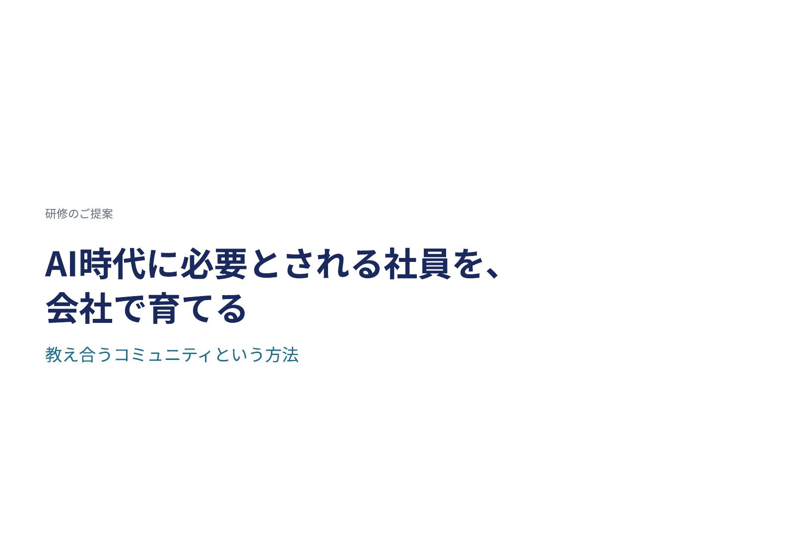

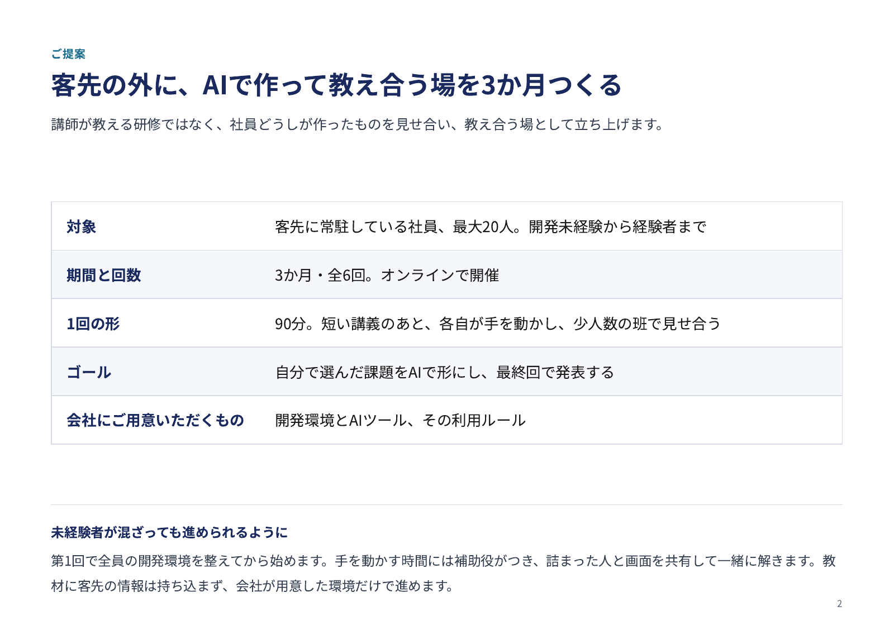

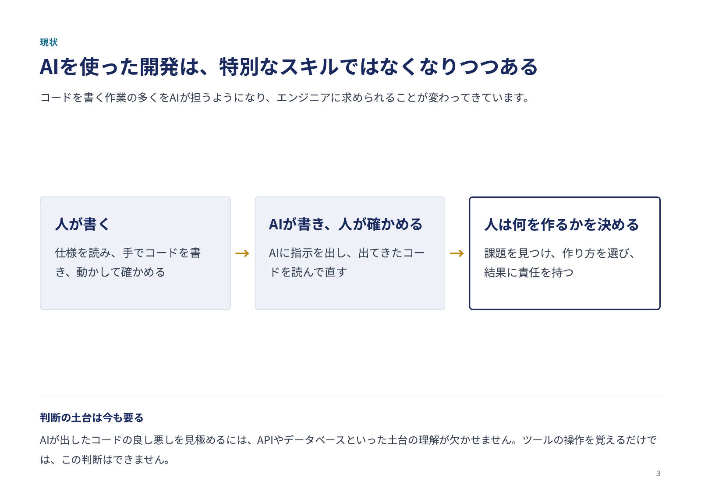

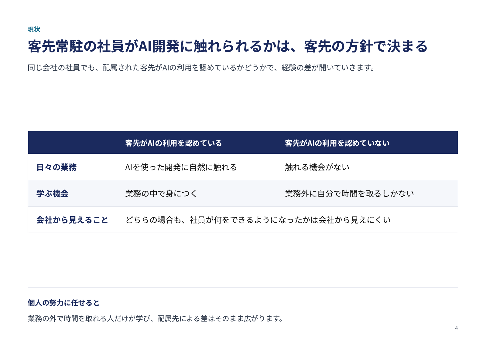

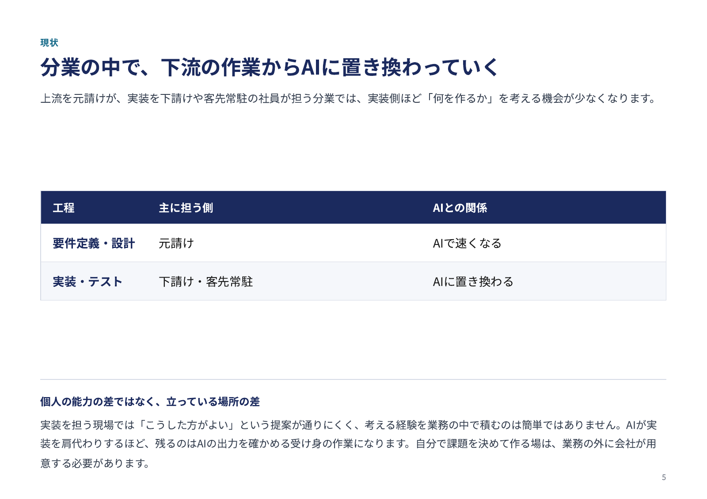

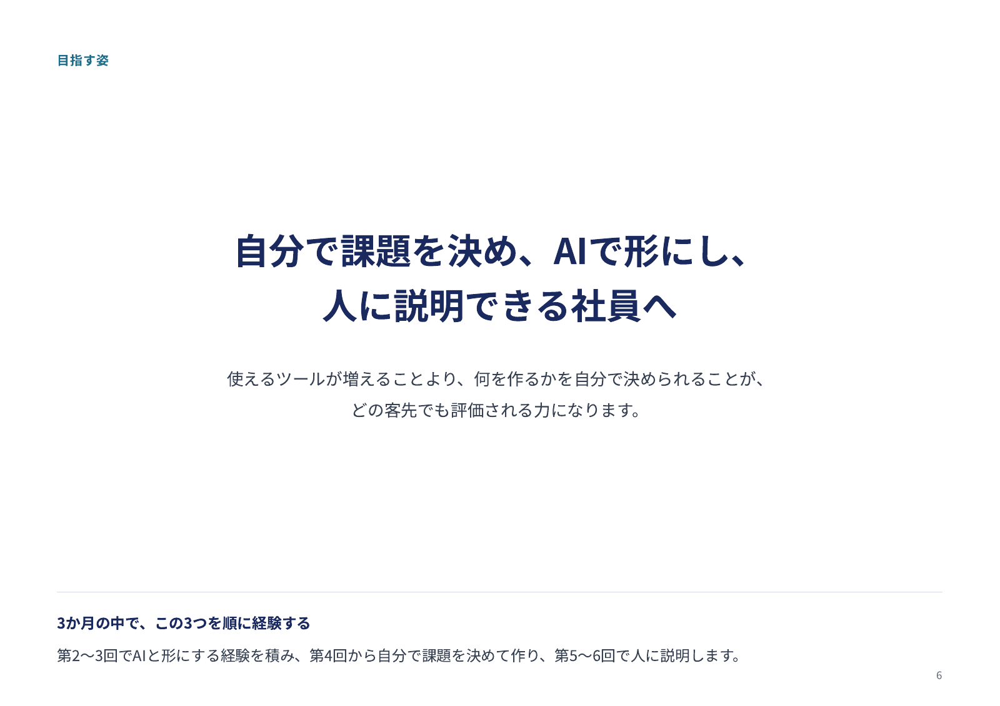

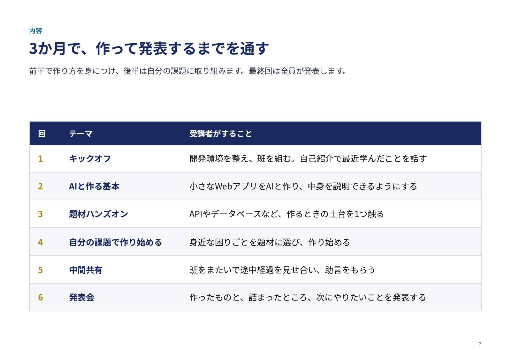

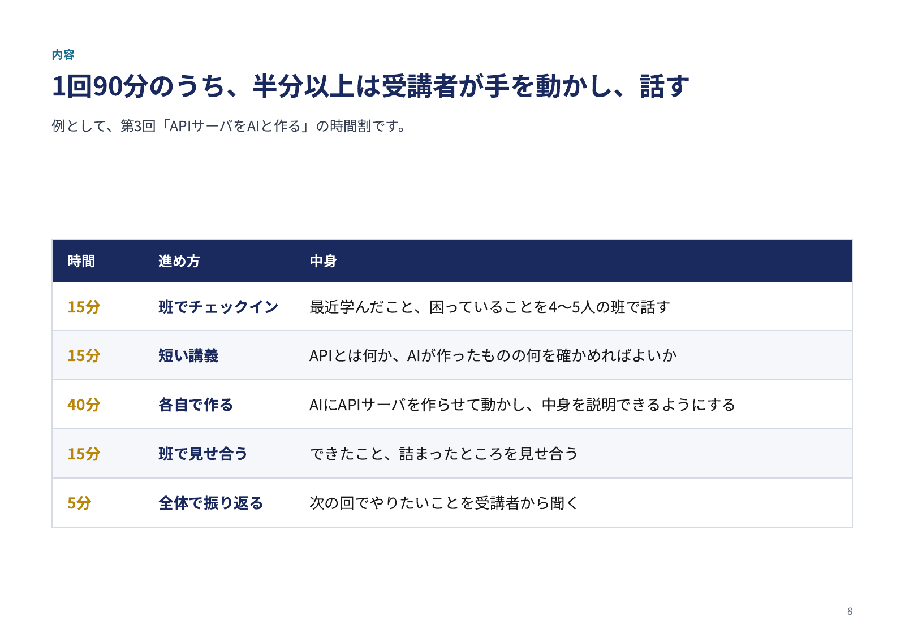

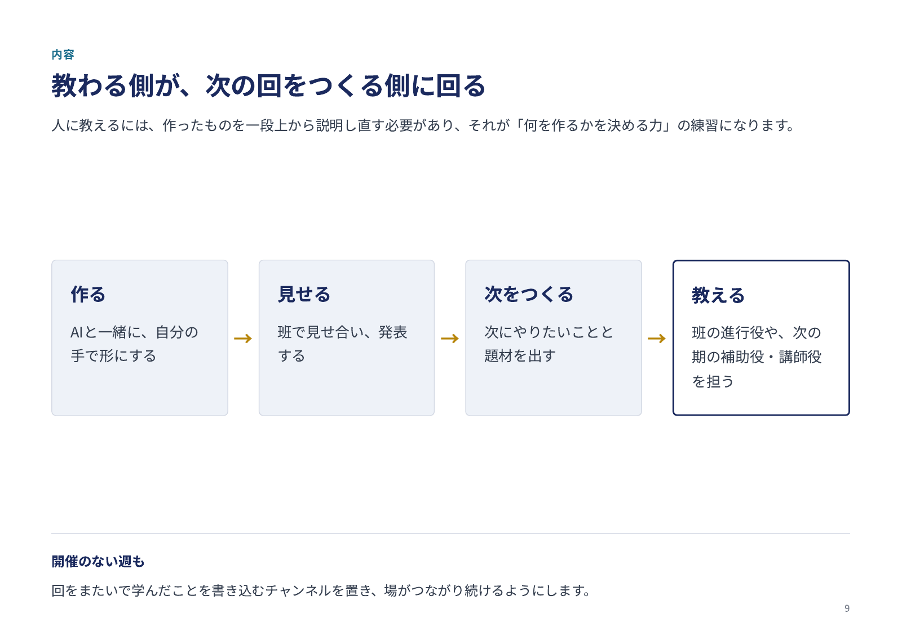

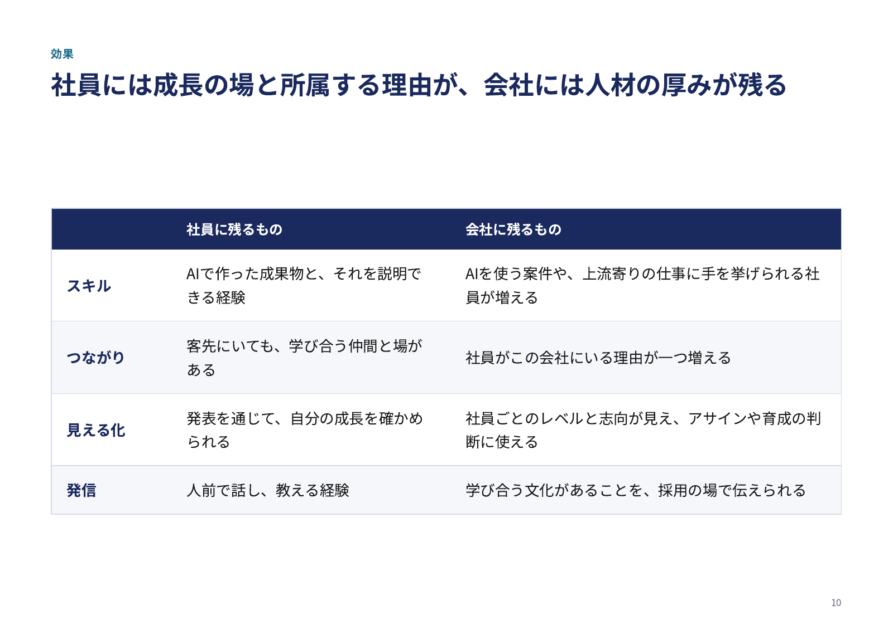

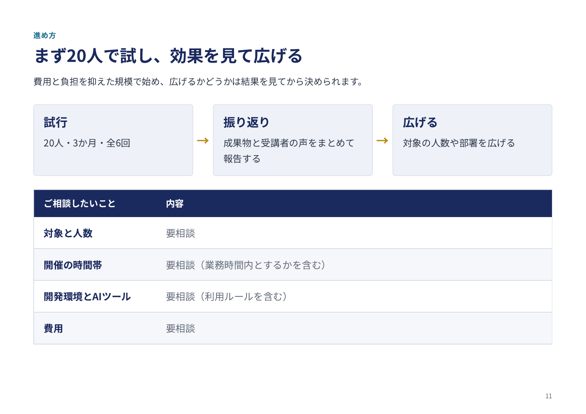
